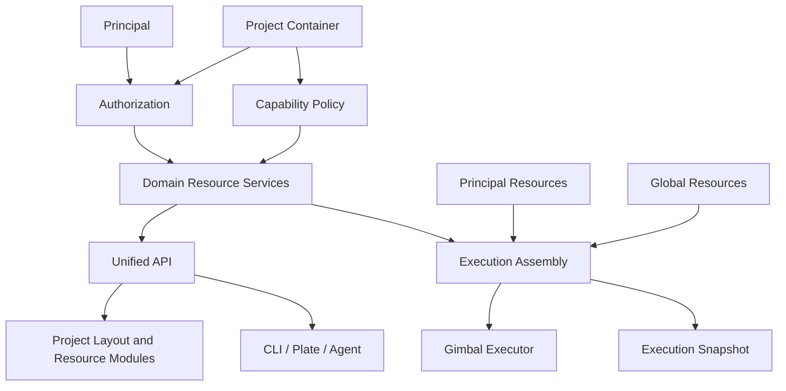
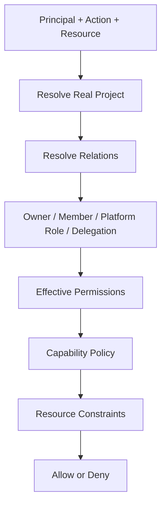
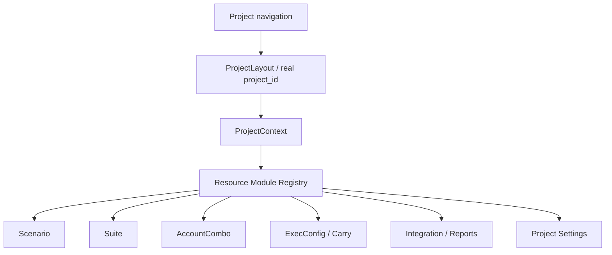
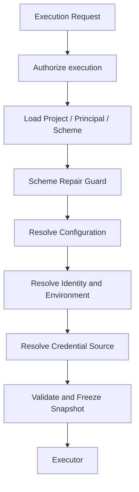
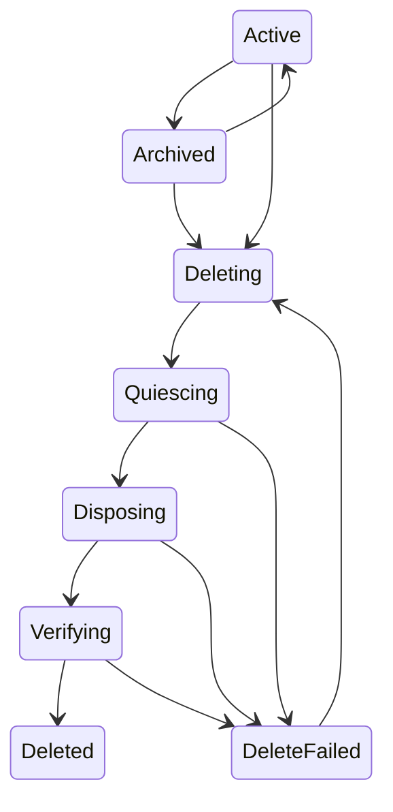
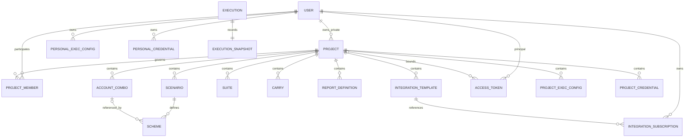
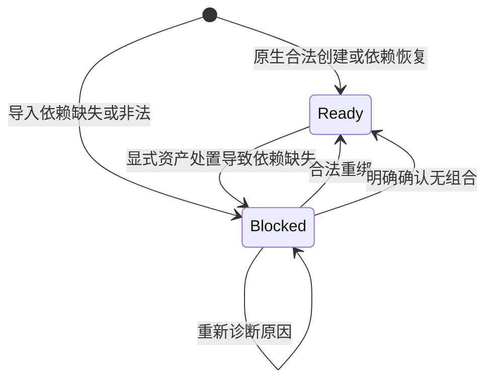

# Gimbal 统一项目上下文架构设计

> Unified Project Context (UPC) · v2.10 · 冻结实施基线（开发库重建与场景资产保护）

| 项目 | 定义 |
|---|---|
| 基线 | main @ 3e71a99896450101f9f5a3af02d637c30ff4a9f0（远端已核对） |
| 类型 | 平台领域架构重构 |
| 优先级 | P0 |
| 状态 | 设计契约冻结；工程验证尚未执行 |
| 交付方式 | 目标模型一次切换，开发库重建，选定场景导出/导入 |
| 替代文档 | UPC v1.0、v1.1、v2.0、v2.1、v2.2、v2.3、v2.4、v2.5、v2.6、v2.7、v2.8、v2.9 |

**实施起点。** 从上述 main 提交派生实现，迁移接在 0066_incremental_model_align 之后。AccountCombo 是本次新增能力，直接创建最终项目归属模型、Scheme 显式绑定、API、装配与页面。组合分支仅提供历史需求与评审证据，不合并、不 cherry-pick，也不以其数据库作为升级输入。M0 按 main 重定位所有调用点。

## 1. 背景与设计原则

Gimbal 是面向 AI Native Harness 的 Environment，平台承担资源组织、治理、配置和执行装配职责。当前私有、公共、普通项目采用不同归属表达，导致领域功能、查询、授权、配置解析及前端渲染存在重复适配。目标是将 Project 定义为统一资源治理容器，而非仅表示多人协作项目。

**资源归属统一、业务能力统一、权限入口统一、治理策略分离、运行上下文正交。**

- 先定义正确的目标领域模型，再重构代码、重建开发库并恢复选定场景资产。
- 所有项目归属型活跃资源必须具有真实项目归属；物理统一是必交付项。
- 同一领域功能实现一次，三种容器共享模型、服务、API、页面与组件。
- 容器类型表达治理方式，不表达不同的资源结构或执行机制。
- 不维护旧 API、虚拟项目、旧 scope 适配器、双写或双形态业务查询。
- 保留的数据不得伪造历史事实；数据完整性、安全隔离为硬约束。用户已确认现存数据均为开发测试数据；选定场景定义优先保留。实际破坏性操作前仍须核对目标库及导出结果。旧行为不自动构成契约，变化须按新契约测试。
- 不强制主体级、全局级、运行时资源项目化；不重写 Gimbal Executor，不引入通用动态策略引擎。

## 2. 现状审计与重构输入

下表沿用 v1.1 的归属盘点；本版另对下列关键调用点进行了本地静态复核。路径相对 `src/gimbal-platform/backend/app/` 或 `src/gimbal-platform/frontend/src/`，行号为旧基线。

| 对象 | 旧形态 | 目标 |
|---|---|---|
| Project | normal/public；name 全局唯一，无 owner_id，kind 无 CHECK | 真实 private/public/normal 容器 |
| Scenario、Suite、集成模板、报告定义 | NULL project_id + owner_id 表达私有 | 非空项目外键 |
| AccountCombo | main 尚无组合业务表；旧审计的多态模型仅见于实验分支 | project_id 外键 |
| ExecConfig | 用户与项目多态 scope | 主体级和容器级显式归属 |
| Carry | 公共层、项目层；个人层已退役 | 统一容器配置与主体执行配置覆盖 |
| Execution | project_id 为派发快照，无外键；NULL 有多义 | 显式历史上下文 |

对象级权限已集中于 `routers/_ownership.py` 的 can/can_pure 与表 B；`services/zone.py` 的 zone_read_clause 仅四处调用。旧基线约 48 行/20 文件以 project_id 判空表达私有语义，36 处/12 文件比较多态 scope，约 56 处公共与非公共比较。前端约 140 行/32 文件按区判断，场景和套件各有三套列表。数字仅为 grep 级审计，不作为代码压缩承诺。

### 2.1 历史分支审计线索（实施时以 main 为准）

| 当前源码（9ebc6349） | 本版落实位置 |
|---|---|
| services/scenario_import.py:950 先提交场景，再创建默认方案并写审计；scheme_store.py:105 内部提交 | §14.2 场景恢复事务 |
| services/zone.py:147 的同区触发器挂在 suite_members；models/suite.py:77 使用两个单列外键 | §20.6 父对象移动完整性 |
| services/carry_injection.py:66 按服务、环境实例、别名逐路径选值；run_dispatcher.py:1313 另取项目配置覆盖 | §11.2、§11.4 配置单选及层内合并 |
| services/integration_runner.py:487 解析实际 Scheme，:645 将组合纳入指纹 | §11.5 执行目标、暂停与重新确认 |
| routers/auth.py:323 按平台能力选择全项目查询；ProjectDetailView.vue:490 异步返回后直接更新列表 | §6 可见性、§10 异步状态 |
| services/scheme_store.py:58 与 services/account_combo.py:39 使用 Python 整数类型判断 | §20.5 从原始 JSON 分类 |

## 3. 目标架构与领域边界



| 领域 | 归属 | 示例 |
|---|---|---|
| Container | Project | Scenario、Scheme、Suite、AccountCombo、项目执行配置、Carry、报告定义、集成模板、项目凭证 |
| Principal | User/授权主体 | 个人凭证、个人执行配置、偏好、AccessToken（个人或项目边界授权凭据）、IntegrationSubscription |
| Global | Platform | 服务目录、环境部署、平台常量、全局治理配置 |
| Runtime | Execution/Job | 执行实例、装配快照、日志、报告实例 |

AccessToken 属于 Principal / Authorization Credential；Project 仅提供可选授权边界，不拥有 Token。项目令牌入口是按边界管理的授权视图，不是容器资产 CRUD。

容器归属、操作主体、凭证来源、执行环境、历史快照是独立维度。Project 是逻辑资源隔离域，不代表独立进程、网络或物理数据库。

## 4. UPC-01：Project 容器模型

```python
class ProjectKind(str, Enum):
    PRIVATE = 'private'
    PUBLIC = 'public'
    NORMAL = 'normal'

class Project:
    id: int
    project_uid: UUID
    kind: ProjectKind
    name: str
    owner_id: int | None
    created_by: int | None
    is_default: bool
    description: str
    default_environment_id: int | None
    status: ProjectStatus
```

以上为目标逻辑模型，不是 ORM 成品。owner_id 表达所有权，created_by 表达审计；普通项目由成员治理，公共项目由平台治理；两者 owner_id 必须为空，created_by 不赋予权限。

| 属性 | Private | Public | Normal |
|---|---|---|---|
| 数量 | 每用户多个 | 平台一个 | 多个 |
| 创建 | 默认空间自动创建，额外空间授权创建 | 系统初始化 | 授权创建 |
| 所有者 | 必须存在 | 平台治理 | 无个人 Owner |
| 成员关系 | 禁止成员行 | 禁止成员行 | 支持成员角色 |
| 可见性 | 所有者（未来可扩展明确委托） | 平台授权范围 | 成员（未来可扩展明确委托） |
| 默认环境等配置 | 统一结构 | 统一结构 | 统一结构 |
| 删除 | 非默认空间可授权删除 | 禁止普通删除 | 授权删除 |

数据库约束：kind 合法；private owner 非空；public 唯一；is_default 仅适用于 private；每 owner 至多一个默认私有项目（部分唯一索引），用户初始化事务保证至少一个。系统用户（如 __platform__）不自动创建私有空间。默认空间删除须先原子指定另一默认空间或进入用户处置流程。项目名称在 private 所有者域、normal 平台域内唯一，public 固定系统标识；名称不作为身份。所有者可修改私有空间名称及配置。生命周期状态包括 active/archived/deleting/delete_failed，归档禁止新写入和新执行，历史可按授权读取。

```sql
CREATE UNIQUE INDEX uq_private_default ON projects(owner_id)
WHERE kind = 'private' AND is_default = TRUE;
CREATE UNIQUE INDEX uq_public_project ON projects(kind)
WHERE kind = 'public';
```

创建入口包括注册、管理员创建用户及迁移；并发幂等，失败事务回滚。无需为 private 所有者生成伪 admin 成员行。

## 5. UPC-02：资源归属与引用完整性

| 资源 | 目标归属与约束 |
|---|---|
| Scenario | project_id NOT NULL FK；creator/maintainer 为独立审计或治理属性 |
| Scheme | 从 Scenario 派生项目；物理 project_id 为受复合 FK 约束的冗余校验键，见 §20.2 |
| Suite | project_id NOT NULL FK；UNIQUE(project_id,name)，替代 owner_id+name |
| AccountCombo | project_id NOT NULL FK；项目内名称唯一、至多一个默认组合 |
| IntegrationTemplate | project_id NOT NULL FK |
| IntegrationSubscription | 拆分为 Principal 域 IntegrationSubscription；执行事实进入通用 Execution，禁止模板实例同表 |
| ReportDefinition | project_id NOT NULL FK |
| ProjectExecConfig | project_id NOT NULL FK；项目内默认项唯一 |
| PersonalExecConfig | principal_id FK；独立主体语义，与项目配置共享 payload/解析实现 |
| Carry | 项目绑定使用真实项目外键；公共项目层作为明确继承源 |
| ProjectCredential | project_id FK；秘密生命周期独立 |
| AccessToken | Principal 授权凭据；principal_id FK，project_id 为可选授权边界，非容器所有权 |
| Execution / ReportInstance | 显式运行时快照，不依赖活跃项目存在 |

ExecConfig 采用单表显式互斥 FK：principal_id 与 project_id 恰一非空，归属类型由字段及约束明确，禁止无外键 scope_id。个人配置仍可在任何有权执行的项目中显式使用。

Suite→Scenario（物理约束见 §20.6）、Scheme→AccountCombo 必须硬同区，即使两个私有空间属于同一用户；跨区引用必须是明确声明的关系类型、具备源读/目标写授权及生命周期规则。Scheme→AccountCombo 使用 §20.2 的显式列与复合 FK，禁止 JSON 内保存权威绑定；其他可表达不变量由数据库约束保护，服务事务保护复杂依赖。禁止普通 PATCH 修改 project_id，移动/复制/发布采用独立操作。项目删除不得无条件级联删除业务资产。

### 5.1 账户组合 v4

保留 service→alias 映射、entries、revision、方案级绑定、零凭证池规则及快照溯源；不把凭证、地址、执行参数塞入组合。硬同区统一为 combo.project_id == scenario.project_id。绑定以 Scheme.account_combo_id 为唯一持久化事实，绑定及执行装配均验证引用合法性及 §20.3 修复状态；引用中的组合不可直接删除。默认组合只用于新方案预选，不隐式改变已保存绑定。组合变更影响下一次装配，历史快照不变。映射优先级：步骤直接引用 > 方案显式绑定 > 组合映射 > service key 回退；完整后端解析细节需在 M0 与 v4 契约核对。

## 6. UPC-03：统一授权体系



Owner 是所有权关系，Admin 是授权角色；不重复存储同一事实。项目成员表仅记录真实协作关系。Token 是认证凭据及授权范围，不是天然独立主体。Agent 必须有明确主体或委托关系。

```python
def authorize(principal, action, resource_or_target):
    context = resolve_project(resource_or_target)
    relations = resolve_relations(principal, context)
    return evaluate(relations, action, context.policy, resource_or_target)
```

授权公式：Allowed = authenticated AND active principal AND permission AND token/delegation scope AND capability AND resource constraint。未知操作、未知类型、无归属、无授权默认拒绝。列表、搜索、聚合使用与对象鉴权同源的 SQL 可见性谓词；禁止先取全集再在客户端过滤。创建以目标项目和资源类型鉴权，批量操作逐对象检查。

| 主体 | 读 | CRUD | 执行 | 成员治理 |
|---|---|---|---|---|
| Private Owner | 是 | 是 | 是 | 否 |
| Private 其他用户（含平台管理员） | 否 | 否 | 否 | 否 |
| Public 普通用户 | 是 | 否 | 否 | 否 |
| Public 维护者 | 是 | 按维护授权 | 否 | 否 |
| Public 平台治理者 | 是 | 按发布/下架授权 | 否 | 否 |
| Normal Admin | 是 | 是 | 是 | 是 |
| Normal Member | 是 | 是 | 是 | 否 |
| Normal User | 是 | 否 | 是 | 否 |
| Normal 非成员 | 否 | 否 | 否 | 否 |

表为本版规范性授权基线，须与 §7 能力矩阵同时求值；公共执行关闭并非结构限制。平台 Control Plane 管理项目元数据、治理状态与最小化诊断；Data Plane 读取、修改、执行资产须独立授权。平台管理员不能自动读取他人私有数据。所有权转移、秘密读取、令牌签发、成员变更、项目删除使用专门权限，不等同普通 CRUD。权限标识采用 `scenario.read`、`account_combo.delete`、`project.member.manage` 等资源动作命名。权限撤销、停用、令牌失效后不得使用缓存继续授权；运行任务的撤销/终止策略单独明确。

M1 引入私有项目行时，同批替换 /auth/me 与 /projects 的项目查询，并复用 context、对象读取所依据的项目可见性条件。用同一组 private/public/normal 数据分别验证所有者、普通成员、非成员和具有 ops.write 的非所有者；列表返回的 ID 集合与逐项目读取结果一致。

## 7. UPC-04：能力与治理策略

能力表示容器允许什么，权限表示主体能做什么，资源约束表示当前对象能否做。三者分别求值，拒绝原因可区分但不得泄露私有资源存在性。

以下为本版唯一规范性能力矩阵，后端、前端、运行解析及验收共同引用。开启不等于主体已授权；关闭必须在 API 层拒绝；不适用表示领域关系不存在。

| 能力 | Private | Public | Normal |
|---|---|---|---|
| 场景、套件、报告、模板 | 开 | 开（发布/维护权限） | 开 |
| 账户组合 | 开 | 关 | 开 |
| 项目 Carry | 开 | 开（公共基线） | 开 |
| 项目默认环境 | 开 | 关 | 开 |
| 项目 ExecConfig | 开 | 关 | 开 |
| 项目凭证池 | 关 | 关 | 开 |
| 项目边界 Token 签发/使用 | 关 | 关 | 开 |
| 执行/调度 | 开 | 关，复制后执行 | 开 |
| 成员管理 | 不适用 | 不适用 | 开 |
| 改名/归档/删除 | 开（默认空间保护） | 系统治理，禁止普通删除 | 授权开放 |

私有凭证池与令牌关闭是为了避免当前无必要的秘密命名空间和授权面扩张；私有 Carry、默认环境和项目 ExecConfig 则保留，因为它们属于容器而非主体，可隔离同一用户的多个空间。不得复活个人 Carry 或个人环境默认层。能力关闭不改变统一结构；成员关系限制及公共唯一性属于领域不变量。策略集中注册、默认拒绝，不引入动态策略引擎。未来开放能力须修改此矩阵及对应测试。

### 7.1 交付分层

| 层次 | 契约 |
|---|---|
| L1 Structural Capability | 统一实体、关系、外键、归属及扩展边界 |
| L2 Functional Capability | 同类资源统一服务、API、组件和规则 |
| L3 Governance Policy | 集中决定能力是否开放及主体授权 |

UPC Core 包含多私有空间、统一物理容器、授权、配置、Integration 拆分、执行解析、前端、开发库迁移及清理。治理增强包括私有项目凭证池开放、私有 Token 签发、公共组合开放、Agent 独立主体、委托授权、跨容器共享。不得为尚未开放的能力建立第二套结构；本期不实现尚无用例的 Grant 系统。

## 8. UPC-05：后端服务与模块结构

```text
platform/
  projects/       # 容器、生命周期、上下文
  authorization/  # 关系解析、权限、可见性
  policies/       # 能力及运行策略
  resources/      # 各领域服务与仓储
  configuration/  # 配置解析、凭证引用
  execution/      # 装配、调度、快照
  api/            # 统一契约
```

目录为逻辑职责示意，不强制实际文件路径。复用合理的现有实现，但不保留为兼容而存在的分支。各领域保留自身业务规则，不建设万能 CRUD 表或无类型资源仓库。统一项目查询、可见性、默认项、引用检查、审计和事务边界。导入必须明确目标 project_id；UI 可预选默认空间但 API 不隐式猜测归属。导出、提升、复制、脚本及批量操作使用统一授权与归属规则。

## 9. UPC-06：API 契约

```text
GET    /projects
POST   /projects
GET    /projects/{project_id}/context
PATCH  /projects/{project_id}
DELETE /projects/{project_id}
GET    /projects/{project_id}/scenarios
POST   /projects/{project_id}/scenarios
GET    /projects/{project_id}/account-combos
POST   /projects/{project_id}/account-combos
PATCH  /projects/{project_id}/account-combos/{id}
POST   /projects/{project_id}/scenarios/{id}/execute
POST   /projects/{project_id}/scenarios/{id}/copy
```

路由为建议目标契约，最终 OpenAPI 在 M0 定稿。路径与父资源归属不一致拒绝；请求体不允许覆盖路径归属。分页、筛选、排序、并发 revision、错误码及审计统一。无访问权的私有对象与不存在对象采用一致的 404 策略；已可见但无操作权返回 403；引用冲突 409；非法输入 422。旧 scope 参数和旧接口直接退役，不提供业务兼容层。

```typescript
interface ProjectContext {
  id: number
  kind: 'private' | 'public' | 'normal'
  name: string
  isDefault: boolean
  effectivePermissions: Record<string, boolean>
  capabilities: Record<string, boolean>
  configuration: ProjectConfigurationSummary
}
```

Scheme DTO 返回 repairStatus、经 §20.3 授权投影的 repairReason 与 revision；禁止直接序列化内部原因及审计标识；修复操作使用专门命令，普通 PATCH 不得清除阻塞。Context 不返回秘密或全部对象级权限；对象状态约束由资源接口及后端实时判断。

## 10. UPC-07：前端统一领域渲染



ProjectLayout 是统一的大容器，领域模块是可复用控件。每个模块只实现一次列表、编辑、详情、操作及数据加载。Private/Public/Normal 不再拥有独立领域页面。导航建议支持项目列表分组、默认私有空间快捷入口、多个私有空间选择；全局选择器的具体视觉方案独立评审。路由建议 `/projects/:projectId/:module`，跨项目聚合入口复用同一组件并显式携带实际归属。

- 以真实 project_id 作为路由、缓存、草稿及异步请求隔离键；切换时取消请求或使用序号守卫，禁止旧响应覆盖新空间。
- 页面和操作由能力与权限渲染，不在业务组件散落 kind 判断；后端独立鉴权。
- 草稿未保存保护、深链接恢复、项目归档/删除、权限撤销及错误状态统一处理。
- 归一 kind/visibility/列表 scope/组合 scope 中重复归属语义；保留 Carry 层级、credentialSource 等正交概念，Bucket 仅为 UI 分组。
- 账户组合页面删除个人/项目归属单选，使用当前项目；统一 CRUD、默认项、诊断、引用及探测上下文。新建并绑定明确创建与方案保存两个事务及失败反馈，禁止将草稿绑定显示为已保存。
- 收敛 ScenariosMine、ScenariosPublic、ProjectScenariosTab 及套件同构列表；修复 ProjectDetailView.loadSuites 异步串写。账户组合页面直接采用新契约，不先为旧架构重复重构。

列表请求以项目、模块、筛选、排序、页码及请求序号辨识。切换项目立即清理上一项目的展示；只有当前请求可写 items、total、loading、loaded 或显示错误。防抖回调在上下文失效时取消。AC-52 同时覆盖跨项目与同项目连续筛选。

## 11. UPC-08：统一执行装配

旧基线环境链为身份标签 > 项目默认 > 平台默认；显式环境、方案环境、执行配置环境、个人环境偏好已退役。Carry 为公共项目层 < 项目层 < 执行配置覆盖，个人 Carry 层已退役。凭证由 credentialSource 选择个人或项目池。以下规则由本轮裁定细化，具体执行样例及失败语义见 §11.2–11.5。



| 维度 | 目标规则 |
|---|---|
| 环境 | 身份标签 > 项目默认 > 平台默认，所有容器同一链；不接受已退役的显式环境参数，身份与部署不一致则拒绝 |
| Carry | 公共基线 < 当前项目 < 选定执行配置覆盖；公共项目自身只应用一次 |
| 执行配置 | 显式选定 > 项目默认 > 无配置；个人默认仅供交互预选，不参与后端自动解析 |
| 身份映射 | 步骤直接 > 方案显式 > AccountCombo > service key |
| 凭证池 | 显式来源或方案策略；个人池按主体授权，项目池按项目秘密权限；不跨池静默回退 |
| 内置凭证 | 禁止在场景资产嵌入秘密；使用授权凭证引用；选定保留场景剥离无法映射的秘密并禁止执行直至修复；其他场景可丢弃 |
| 调度 | 每次派发重新验证主体、项目、令牌、资源及执行权限；撤销后停止新派发 |

RuntimePolicy 集中描述允许的凭证来源、秘密引用规则、调度限制等；解析器消费实际配置与权限，不把 project.kind 当作执行分支。执行器继续消费确定性装配结果。快照记录项目、主体、方案/组合 revision、环境、配置来源及凭证引用，不保存明文秘密；回放必须重新授权并解析有效秘密。

### 11.1 五处旧行为开关的重构清单

| 旧位置 | 旧语义/风险 | 目标 |
|---|---|---|
| run_prepare.py:513-519 | 内置凭证仅私有，迁移后静默失效 | 禁止资产内嵌秘密，改为凭证引用 |
| exec_config.py:120-128 | 私有默认配置覆盖 | 统一配置选择规则 |
| carry_injection.py:187-189、run_prepare.py:909-913 | 私有无项目 Carry | 统一继承链 |
| env_chain.py:104-108 | 私有无项目默认环境 | 统一环境链 |
| integration_runner.py:1140-1158 | 私有属主绕过成员门 | 统一执行授权 |

按目标契约构造代表性装配样例；不要求旧数据基线或行为等价。订阅指纹、调度状态及保留的历史快照同样验证。

所有涉及 Scheme 的装配入口在授权后先执行 §20.3 Scheme 修复闸，未通过不得解析秘密、探测、发送请求或派发任务。

### 11.2 ExecConfig：单选与失败关闭

优先级 Explicit > ProjectDefault > None，所有容器一致，不依赖 kind 或执行人。显式选择自己的个人配置或当前项目配置；其他项目配置禁止。仅未设置才继续解析，已选配置不存在、失效、无 use 权限、归属错误或 payload 校验失败均拒绝，不降级。区分 `exec_config.use` 与 `exec_config.read`。

| 显式 | 项目默认 | 个人默认 | 结果 |
|---|---|---|---|
| 无 | C1 | P1 | C1 |
| P2 合法 | C1 | P1 | P2 |
| C2 合法 | C1 | P1 | C2 |
| 无 | 无 | P1 | 无配置 |
| 无 | C1 无 use 权限或失效 | P1 | 拒绝 |
| P2 不存在或无权 | C1 | P1 | 拒绝 |
| 无 | 无 | 无 | 无配置 |

个人默认仅为 UI 预选，用户确认后以显式参数提交；调度订阅明确绑定所需个人配置，Agent/CLI 显式传参。未绑定时按项目默认解析。新设项目默认影响下一次未显式选定配置的执行，历史快照不变。ExecConfig 不包含凭证池适用性字段，不因个人池/项目池不同而拒绝合法配置；不得改变 credentialSource。配置只校验存在性、有效状态、归属、use 权限及 payload 契约。个人配置仅实际执行主体可显式选择，项目配置仅当前项目可用；项目边界 Token 仍须满足其 scope 与边界约束，不得借配置扩大权限。凭证来源及秘密引用由 §11.3 独立校验。个人凭证的主体差异仍然合法，不等同于隐式配置差异。

单选对配置的全部字段生效。验收例：项目 Carry 提供 region，项目默认 ExecConfig 提供 timeout，显式个人 ExecConfig 仅提供 locale。结果保留 region 和 locale；若其他来源未定义 timeout，结果中该字段缺席。预览、执行和调度使用同一选择结果。

### 11.3 凭证来源与认证约束

先解析认证主体、Token 范围和强制来源。项目 Token 固定项目池；显式请求冲突拒绝，方案默认与强制约束冲突时以强制来源为准并记录来源决策。无强制来源时按 Request > Scheme > SystemDefault 选候选。允许集合为主体权限、Token 约束、容器策略的交集。候选不在集合内即拒绝；只查选定池，缺失、歧义、权限不足均不得跨池回退。系统默认值须在 M0 按执行入口明确登记，不得由解析器猜测。

| 认证 | 个人池 | 项目池 |
|---|---|---|
| JWT | 实际主体授权 | 项目权限及能力 |
| Personal Token | 主体权限与 scope | 项目权限、scope 与能力 |
| Project Token | 禁止 | 强制当前绑定项目 |

账户组合不决定凭证来源；禁止内置秘密；零池规则须按 v4 全量契约实现。环境仅按身份标签 > 项目默认 > 平台默认解析，拒绝退役环境字段及身份/部署不一致。

### 11.4 Carry 合并

公共项目 Carry → 当前项目 Carry → 选定 ExecConfig Carry。公共项目自身仅应用一次。缺键保留；null 显式注入 JSON null；空字符串保留为空字符串；数组整体替换；对象同类型递归合并；类型不同及标量整体替换。删除采用独立 JSON Pointer 路径，不复用 null。

```yaml
carry:
  values:
    timeout: 60
    headers:
      version: null
  remove:
    - /headers/legacy
```

每层先合并 values 再执行 remove；不存在路径无操作，高层可重新定义。删除仅允许对象键路径，禁止数组索引及根路径删除；非法路径拒绝。

| 公共值 | 项目值 | 配置值 | 最终 |
|---|---|---|---|
| timeout=30 | 60 | 缺键 | 60 |
| tags=[a] | [b] | [] | [] |
| debug=true | false | null | null |
| headers={region:default,version:v1} | {region:test} | {version:null} | {region:test,version:null} |
| legacy=1 | 缺键 | remove /legacy | 不存在 |

**层内键域与删除作用域。** 对当前执行服务，每个容器层依次应用层默认、服务、匹配环境的实例、匹配的身份别名。缺少环境或别名时跳过对应档。每档只作用于当前目标服务的有效 Carry 对象，先递归合并 values，再按声明顺序对该对象执行 remove；层内更具体的档及更高层均可重新定义已删除的键。ExecConfig 只应用所选配置中匹配服务的覆盖。指针相对于该服务对象，按 JSON Pointer 转义解码，非法转义和进入数组的路径拒绝。每个保留叶值记录最后写入它的层和键域，数组作为一个值记录。预览和装配共用解析结果，来源信息仅用于解释。

验收样例：公共服务档写 headers.region=cn、headers.legacy=1；项目服务档写 headers.mode=base，匹配实例改为 instance，匹配别名再改为 alias；选中配置删除 /headers/legacy。最终 headers 只有 region=cn 与 mode=alias，来源分别为公共服务档和项目别名档。另一服务的同名键保持其自身值。再以高层重建删除键验证来源随之更新。

**最终请求取值。** 解析器一次生成每个服务的有效字段及来源，预览、运行和 Suite 单元均消费同一结果。字段删除后，请求物化器不得再查询独立 defaults 表补值；已有请求体显式值、声明面筛选与类型转换继续按既有物化规则处理。以请求本身没有该字段的样例验证删除。项目层默认覆盖公共别名对同一字段的赋值，随后项目层匹配的服务、实例和别名仍可覆盖项目默认。AC-48 以实际发送前的请求体断言最终效果。

### 11.5 通用 Execution 与 Integration

IntegrationTemplate 属于 Project，IntegrationSubscription 属于 Principal，引用真实 template_id，持有 schedule、configuration、credential_source、consent/status；每次派发重新授权。Execution 属于 Runtime，记录一次能力执行事实，禁止用占位 scenario_id 或 config_json 隐式表达来源。

Execution 目标字段：id、source_type（scenario/suite/integration_subscription/ad_hoc）、source_id、source_revision、project_id_snapshot、project_uid_snapshot、principal_id_snapshot、source_snapshot、execution_context_snapshot、status、started_at、finished_at。新执行必须具有可验证来源；ad_hoc 仅在真实临时执行能力存在时使用，可按类型约束缺少来源 ID。Integration 快照记录 subscription_id、template_id、template_revision。历史来源标识不作为活跃多态外键；活跃订阅必须有真实模板和主体外键。快照不得包含明文秘密。本次开发库重建不导入旧执行记录，不引入历史专用类型或迁移标记；新系统正常生命周期中的历史快照规则不变。

**模板来源与实际执行项目。** 可调度订阅必须绑定可执行项目中的本地模板。公共模板经源读取、目标写入和复制授权后，在 private 或 normal 生成本地模板并确定性映射目标 Scenario/Suite 及 Scheme；保留公共模板的来源标识与版本。依赖未就绪时禁止启用订阅。订阅引用本地 template_id，实际目标、模板及所属 Scheme 必须落在同一执行项目。派发以订阅主体重新校验模板读取、目标执行、凭证 use 和订阅状态；Execution 的项目快照取实际执行项目。

未指定 Scheme 时，按该目标既定默认选择规则解析，并将实际选择写入订阅确认指纹；显式 Scheme 缺失、已移动、跨场景或 blocked 时暂停，禁止改跑默认方案。合法的显式原始模式单独表示。确认指纹包含实际目标项目、模板及版本、实际 Scheme 及修订、组合 ID 及修订，并保留现有影响同意范围的输入。每次派发在外部副作用前复核；目标移动、实际默认变化或组合修订造成指纹变化时暂停并要求重新确认。快照记录本次使用的版本。Suite 按所选成员逐一核验。

**订阅确认所指向的 Scheme 身份。** 新增不可变 scheme_uid（服务端生成 UUID，唯一、非空，不允许客户端指定或重新使用）。迁移给每个保留行分配身份；复制、导入新行和删除后重建均生成新身份，同次导入幂等重试沿用已提交的映射。rs-NNN 继续用于业务寻址。显式选择在创建或重新确认事务中解析并固化 UID；订阅保存已确认的选择模式和 UID，Suite 按成员保存。删除 Scheme 后仍保留已确认身份作比较，不因删除而转成默认模式。派发同时校验实际 UID、所属场景、项目、revision 和 §20.3 状态；当前引用失效即暂停。默认模式的指纹也纳入解析后的 UID；无唯一合法默认时暂停，禁止选第一条。原始模式无需 Scheme，须显式确认。首次启用与重新确认提交预览时的 expected_fingerprint，事务内重算不一致返回 409，保持原状态。每次派发均比较指纹，包括模板所有者自订阅。首次启用、重新确认与每次派发使用同一指纹算法，快照记录实际 UID。禁止仅凭相同业务 ID 自动承接已删除对象的订阅。

## 12. UPC-09：Plate / Agent / CLI 契约

旧 Plate 客户端按系统名、端点 ID、行号寻址，Agent 尚未交付（v1.1 基线）。本期预留统一项目资源发现与操作契约，不要求实现完整 Agent 或重写 Plate 协议。

```text
Principal --owns/memberOf/delegatedTo--> Project
Resource --belongsTo--> Project
Scheme --references--> AccountCombo
Execution --uses--> CredentialReference
Execution --captures--> ResourceRevision
```

资源描述应包含稳定 ID、project_id、资源类型、版本、引用及允许操作。发现、读取、执行均使用同一授权体系；Agent 不因自动化身份获得额外权限。CLI/API 与 UI 共享业务服务，不建设独立执行语义。

## 13. UPC-10：生命周期与跨域处置

项目创建、归档、恢复、删除、所有权转移均为显式领域操作。删除前生成依赖处置计划，检查资产、默认项、引用、凭证、边界 Token 撤销、Carry、执行配置、调度和历史保留要求。默认私有项目不得直接删除；公共项目不得普通删除。用户停用撤销新执行资格，保留资源；用户删除仅处置其私有容器及主体资源，不因 creator/owner 字段误移动普通项目资产。普通项目最后一个有效管理员离职前必须交接管理员权限或归档。

| 对象 | Publicize | Transfer | Purge |
|---|---|---|---|
| Scenario/Scheme | 迁入公共项目，校验可发布内容 | 迁入指定受让空间或整体转移容器 | 按依赖删除 |
| AccountCombo | 仅迁移目标允许的映射；否则明确解绑或阻断 | 保持引用同区，处理名称/默认冲突 | 引用先处置 |
| Suite/Template/ReportDefinition | 验证依赖及目标能力 | 随依赖迁移 | 按依赖删除 |
| ProjectExecConfig/Carry | 仅发布可公开配置，秘密引用剥离或阻断 | 校验目标配置冲突 | 删除 |
| 项目凭证 | 不公开 | 不自动转移秘密，重新授权 | 按安全策略删除 |
| AccessToken | 不公开；撤销相关授权 | 不随容器转移；撤销受影响的边界授权，必要时重新签发 | 撤销并清理相关边界 Token；不删除无关主体 Token |
| IntegrationSubscription | 暂停，重新验证执行资格 | 重新绑定合法主体 | 停止并处置 |
| Execution | 保留原始历史事实 | 保留 | 按留存策略处理 |

多私有空间下 transfer 必须指定目标项目或明确整体容器所有权转移，不能默认为受让人唯一空间。先发现依赖→验证目标→生成计划→冲突确认→事务执行→验证不变量；外部副作用使用可恢复任务/事务后处理，不假定跨系统原子性。不得静默解绑、覆盖同名资产或转移秘密。公开配置采用默认拒绝：仅经显式确认且通过非秘密内容校验的配置可发布；目标能力关闭时不得迁入。无法确认安全性则拒绝发布。

### 13.1 删除状态机



Deleting 起禁止新写入、授权、执行和调度；Quiescing 撤权、停止调度并处置运行任务；Disposing 停订阅、处置秘密与引用；Verifying 验证依赖清零（含已撤销的边界 Token 行按 FK RESTRICT 要求清理，审计不含秘密）；Deleted 才物理删除。失败保持封闭、可幂等重试。外部副作用不得假定数据库事务可回滚。默认私有空间须先原子切换默认项；用户整体删除可在同一处置事务解除默认约束。保留的合法历史不依赖活跃项目。

### 13.2 历史执行与派生记录的读取

历史数据按执行时的项目定位，普通数据面读取按请求当时的授权判定。具体矩阵如下，报告实例、日志、下载、列表计数与聚合均从所属 Execution 继承相同范围。

| 项目状态 | 当前拥有该项目历史读取权限 | 已移出成员、失权执行人、仅具平台治理角色者 |
|---|---|---|
| active / archived | 允许；仍检查有效主体、令牌及其边界 | 拒绝 |
| deleting / delete_failed / 已物理删除 | 所有普通数据面主体均拒绝 | 拒绝 |

原执行人、原所有者及原成员身份均不单独赋权。列表排除，直接寻址对不可见记录统一返回 404；下载也在实际取件时鉴权。历史记录按留存策略保留，控制面继续遵循 §21 的独立授权与诊断字段限制。回放须同时具备历史读取权和实际目标的当前执行权；归档项目禁止新执行，删除态及删除后禁止回放。项目快照必须携带不可复用的项目身份：为每个 Project 固定服务端生成的 project_uid（UUID，唯一、非空、不可修改或重用），Execution 保存 project_uid_snapshot；查询按此身份关联当前项目。重建同名或同数值 ID 项目无权继承旧历史。M1 两条建库路径包含 Project 身份约束，M3 覆盖所有新执行写入与历史端点。

## 14. 开发库重建与场景资产保护

### 14.1 正式处置决策

用户已确认现存数据均为开发测试数据；唯一可能需要保留的是场景库中有复用价值的场景。采用**重建开发库 + 选定场景导出/导入**，不建设全量业务数据转换程序。旧数据库、旧 Token、旧执行记录、旧配置及其他测试数据不构成目标架构约束。禁止引入历史兼容字段、双写、历史未知类型或长期旧 API。

| 数据 | 处置 |
|---|---|
| 选定场景定义 | 优先完整保留 meta、resources、steps、断言、请求及业务执行描述；保留可用的 Scheme 定义 |
| 场景必要依赖 | 仅恢复实际需要的项目、主体、服务、身份映射、方案及引用资源（含 Scheme 绑定的 AccountCombo）；确定性映射可在导入阶段完成 |
| 内置秘密/失效引用 | 不导出明文秘密；能映射则使用新授权引用，否则保留场景定义、显式记录待修复项并禁止相关执行 |
| 其他场景 | 不要求保留 |
| 用户、项目、Suite、Combo、Carry、ExecConfig、凭证、订阅 | 通过 seed/fixtures 或按需重建；不进行全量转换，不按稳定 ID 任意保留冲突项 |
| 旧 Token、执行、日志、报告实例 | 不导入；旧 Token 失效，按需重新签发 |

### 14.2 操作流程

1. 核对实际目标数据库、环境及共享使用情况；用户已确认开发数据属性，但执行者仍须确认目标连接无误、没有需要保留的共享数据或外部调用契约。发现例外时停止该环境的破坏性操作，不改变目标架构。
2. 确定场景保留清单；尚未选定时先保护全部候选场景，禁止因清单缺失而直接清空场景库。导出场景定义、Scheme 与必要依赖，剥离秘密，记录源标识、内容校验及依赖缺口；验证导出可读、完整且安全。
3. 停止目标开发库的写入和调度，重建数据库，初始化新 schema、系统用户、公共容器、默认私有空间及必要 seed/fixtures。
4. 通过新导入契约明确目标 project_id，恢复选定场景及必要依赖。允许新 ID，记录导入映射并重建引用；能安全保留原 ID 时可保留。名称冲突由明确目标命名解决，不静默覆盖或任意删除选定场景。无法恢复的外部引用解除或保持明确未配置状态，不伪造引用；若无法安全表达待修复状态，则保留导出资产、暂不导入并报告。
5. 核对保留清单、定义内容、引用完整性、权限和秘密安全；对已完成装配的代表性场景执行回归测试，未完成装配的场景必须拒绝执行。输出导出/导入/待修复/未导入计数及重建范围，不要求逐表旧数据删除统计，不输出秘密。

#### Scheme 组合依赖恢复规则

导出清单须记录选定 Scheme 的组合依赖及源标识，不导出秘密。导入时先恢复目标项目内合法组合，再按映射写入显式 account_combo_id，并以复合 FK 校验。组合未恢复、跨区或目标能力关闭时，不得写入悬空引用、猜测替代组合或隐式使用默认组合。可显式解绑（account_combo_id = NULL），记录原依赖与待修复原因；原本依赖组合的 Scheme 在修复或经明确确认采用无组合运行语义前必须拒绝执行和调度。待修复状态必须按 §20.3 持久化，并由统一装配闸检查全部入口；若无法安全表达该状态，则暂不导入该 Scheme，保留导出资产并报告，不丢弃场景定义。原本无组合依赖的合法空绑定不受此限制。导入必须原子写入绑定、修复状态及审计，不能先提交空绑定再补状态。导入报告区分已恢复绑定、显式解绑待修复、未导入 Scheme；不得将待修复项计为可执行。

场景保护是资产恢复，不是旧数据库状态恢复；不得为保留场景而改变目标领域模型。场景定义实际字段及依赖尚需实现前核实。无需独立全量迁移系统、多轮恢复演练或在线双写。

#### 按场景原子恢复与重试

资产包为每个场景列出稳定源标识、内容摘要、选定 Scheme、唯一默认选择、数据集及其选择关系、组合与其他必要依赖的映射。若原默认方案未入选，清单须显式指定合格的目标默认方案或报告待处置。默认方案要求 dataSetSelection 和 injectionEntryIds 均为空；校验应读取原始选择并识别旧 dataSetIds 形态，先验证再写入。含选择的候选不可通过清空字段升为默认。失败时整场景不提交，保留导出与源选择，重新指定合格候选后重试。成功恢复的非默认方案保留所选数据集、行索引及注入条目的确定性映射；依赖未就绪须报告，禁止悄然清空。依赖可先行准备；引用必须在目标项目重新验证。目标场景、该场景待恢复的方案及其引用、默认标记、修复状态、必要审计和成功映射由上层在一个数据库事务提交。恢复入口调用只 flush 的写入函数；普通新建的默认方案自愈逻辑不得在恢复中另行提交或补建额外方案。若某个方案无法安全表达，先按 §14.2 确定保留导出及报告范围，再提交经验证的恢复单元。

幂等键为目标项目、导出包标识与源场景标识的组合，数据库唯一约束防止并发重复创建。恢复请求摘要覆盖源内容、入选方案、默认选择、目标命名及依赖映射，按规范化后的输入计算。同键同摘要返回已提交的目标映射；同键不同摘要返回冲突供处置。失败回滚该单元，重试可继续；其他已完成单元保留。M2 以主线导出的场景覆盖无组合恢复，并以 UPC 格式样例在独立空库跑通一个带非默认方案、组合和数据集选择的代表性场景，从导出、导入到预检逐项比对数量、默认项、引用映射和阻塞结果。M3 重跑完整装配，M5 按保留清单全量执行。

### 14.3 DDL 迁移链（独立于业务数据保留）

本版选择保留现有 Alembic 升级链及交付快照基线。开发库重建不免除增量升级门：在独立测试库以交付快照沿迁移链升级到 head，验证列、约束、索引、触发器及函数与新库初始化一致。DDL 迁移允许按依赖清理旧测试业务数据，不要求恢复其内容；场景资产须在实际开发库重建前完成 §14.2 的导出保护。不得将破坏性清理误用于未确认环境。重置迁移基线不属于本版范围。旧 Scheme 若被保留，必须按 §20.5 核验主线输入并回填；允许清理不保留的测试 Scheme，但禁止静默丢绑定。结构一致性与升级语义完整性分别验收。

## 15. 安全缺口与源码重构索引

以下为 v1.1 静态发现，需 M0 验证并纳入新架构测试，不是已证实运行漏洞。

| 位置 | 重构要求 |
|---|---|
| routers/auth.py:323-326 | /auth/me 项目列表按授权过滤 |
| routers/projects.py:114-119,339-344,407-408 | 区分治理面与数据面，私有隔离 |
| routers/projects.py:480-486 | 删除闸覆盖所有项目资产及边界 Token 撤销 |
| routers/executions.py:96-118 | 聚合按授权过滤 |
| routers/scenarios.py:606-641 | facets 不泄露私有项目 |
| routers/scenarios.py:498-603 | signals 增加读闸，响应不泄露存在性 |
| routers/carry.py:86-87,204-209 | 能力与 SQL 可见性统一 |
| routers/project_tokens.py:59-66、project_credentials.py:76-85 | 秘密及令牌专门授权 |
| services/project_promotion.py:61-63 | 显式源/目标权限与引用检查 |
| routers/adaptations.py:79-99 | unindexed-steps 默认按资源授权，诊断例外须显式审批 |
| routers/users.py:483 起、666-697 | 用户处置按容器，补孤儿组合/配置 |
| services/zone.py:186-192、routers/suites.py:116、report_definitions.py:80-81 | 统一可见性语义 |
| routers/integration.py:301-313 | SQL 级过滤 |
| services/scenario_import.py、scripts/ | 显式目标项目及审计口径 |
| routers/auth.py:99、routers/users.py:171 | 幂等默认空间创建 |

## 16. 实施计划

| 阶段 | 交付 | 退出条件 |
|---|---|---|
| M0 目标契约 | ER、权限矩阵、配置优先级、生命周期、场景保护清单、基线样例、§20.3 状态模型、诊断投影及装配入口清单；§20.5 旧绑定分类规则 | 目标契约签核；开发数据属性已确认，实际重建操作另设准入 |
| M1 容器与授权 | Project、关系解析、能力策略、数据库约束；§20.2、§20.4 PostgreSQL 验证（隔离目标结构） | 多私有空间、项目列表与对象可见性一致（AC-51）、隔离结构上的 Suite 父端移动及双路径断言通过 |
| M2 领域服务/API | 所有容器资源、Scheme 不可变 UID、引用、导入、生命周期；§16.1 组合绑定读写点收敛、§20.3 修复状态、诊断投影及审计命令、§20.5 主线 Scheme 升级 | 统一契约，无旧归属分支及 JSON 权威绑定；修复状态迁移、§20.5 升级 fixtures、诊断脱敏测试、正式 precheck 的最小链路及 AC-45–47 的恢复闭环与 Suite 约束通过 |
| M3 执行装配 | 配置解析、凭证、环境、调度、快照及统一修复闸 | 新执行契约、全部装配入口负向测试及 AC-48–50、AC-53 通过；复跑 M2 样例的完整装配 |
| M4 前端 | ProjectLayout、模块注册、统一组件与状态 | 三类空间 E2E 及 AC-52 异步乱序测试通过 |
| M5 迁移与验证 | 场景导出、开发库重建、seed、场景导入、独立 DDL 升级验证 | 结构一致、升级绑定语义完整、引用完整、场景恢复报告及目标契约测试通过 |
| M7 清理 | 删除旧接口、字段、适配逻辑，更新文档 | DoD 完成 |

阶段为研发依赖，不要求中间形态部署。DDL 与场景导入能力随 M1–M4 实现；M5 统一验证。M6 并入 M5，不再单设切换阶段。物理模型归一不可选。前端不依赖虚拟上下文。

### 16.1 M2 组合绑定改造清单

下表列出目标职责，main 中缺失的 account_combo 服务和 account_combos 路由直接新建。以下为评审提供的必查模块，实际路径及调用点在实现时核实；清单不是全量扫描结果。

| 模块 | 必须改造的行为 |
|---|---|
| `scheme_store` | 创建、更新、读取、复制及序列化映射显式列；绑定与 revision 同事务 |
| `account_combo` | 绑定解析、引用查询、删除保护及执行装配读取显式列 |
| `auth_references` | 引用与授权检查使用显式关系，不扫描 payload 绑定 |
| `account_combos` 路由 | CRUD、引用统计、删除冲突及绑定相关查询使用显式关系 |
| `run_schemes` 路由 | DTO accountComboId 与显式列双向映射；不写入 payload |
| 导入、复制、移动、发布、调度及执行入口 | 依赖映射、同区校验、待修复执行闸及快照生成遵循 §14、§20.2 |

M2 退出前全仓检索 accountComboId、account_combo_id 及 JSON 路径查询，逐一分类为 DTO、显式列、历史快照或一次性旧资产导出/DDL 清理。正式应用拒绝在持久化 payload 中写入 accountComboId（DTO 映射后剥离）；禁止正式应用读写 payload.accountComboId 作为绑定事实，禁止双写或旧字段回退；历史快照字段仅用于历史展示及审计。M3 验证执行装配和调度同样不读取旧 payload。

## 17. 验收标准

| ID | 验收项 | 通过标准 |
|---|---|---|
| AC-01 | 用户初始化 | 并发创建仅一个默认私有项目，系统用户排除 |
| AC-02 | 多私有空间 | 同一用户创建多个空间，资源独立、默认唯一 |
| AC-03 | 公共项目 | 全局唯一，普通删除拒绝 |
| AC-04 | 数据模型 | 活跃容器资源真实 FK，无 NULL 私有语义 |
| AC-05 | 私有隔离 | 他人及平台管理员经详情、列表、搜索、signals、聚合、执行均不可越权 |
| AC-06 | 角色授权 | Owner/Member/平台角色矩阵符合新契约，无伪成员行 |
| AC-07 | 能力策略 | 三类容器同实现，关闭能力后 API 同样拒绝 |
| AC-08 | 账户组合 | CRUD、默认、revision、硬同区、引用保护、诊断、零池规则通过 |
| AC-09 | 执行装配 | 五处旧开关全部移除，按新契约验证环境、Carry、配置、凭证、调度 |
| AC-10 | 跨域操作 | 复制、发布、移动依赖及授权正确，冲突不部分提交 |
| AC-11 | 前端 | 同一领域组件渲染三区，无缓存泄露、串写、草稿丢失 |
| AC-12 | 历史 | 新执行快照事实不变，回放重新授权；旧开发执行不导入 |
| AC-13 | 迁移 | 开发库重建、场景保护与恢复、独立 DDL 升级验证、引用完整及恢复报告通过 |
| AC-14 | 扩展 | 新项目级功能只实现一次，注册策略即可开放 |
| AC-15 | API | 无旧 scope 接口或双轨业务查询，OpenAPI 与客户端一致 |
| AC-16 | 配置 | 符合 §7 规范性矩阵；个人配置不隐式参与执行 |
| AC-17 | 用户处置 | publicize/transfer/purge 依赖完整，无孤儿，不误移动普通项目资产 |
| AC-18 | 凭证与令牌 | 最小权限、撤销生效、无秘密泄露、无隐式跨池回退 |
| AC-19 | 导入与脚本 | 明确项目归属，审计统计正确 |
| AC-20 | 所有权 | Private Owner 与 Normal 成员治理独立，无重复授权事实，转移后权限正确 |
| AC-21 | 默认拒绝 | 未知类型、动作、未注册能力均拒绝 |
| AC-22 | 删除保护 | 所有项目资产、引用及边界 Token 撤销纳入检查，合法历史按留存策略保留 |
| AC-23 | 数据库一致性 | 按 §20.4 同一套结构断言验证 Alembic 升级与正式新库初始化一致 |
| AC-24 | 权限失效 | 停用、成员移除、令牌撤销后缓存不继续授权 |
| AC-25 | 性能 | 代表性列表/聚合/装配负载及查询计划满足 M0 确定的阈值 |

测试包括数据库迁移、授权矩阵、领域服务、API 集成、执行装配、前端 E2E、负向安全测试。更新现有 `tests/authz_expected.yaml` 及 26 个 test_authz_* 文件（数量来自旧审计）。旧测试不是不可变规范，按新契约调整，但不得通过删除负向用例掩盖越权。安全、数据完整性、执行正确性为发布阻断项。

## 18. M0 准入与决策登记

本版采用 §4–§7、§11、§20–§21 的目标契约，取消历史数据保留、外部调用方切换、在途分支周期及实际历史数据数量作为架构阻断项。仓库内调用方与测试随实现更新。

| 准入事项 | 要求 |
|---|---|
| 目标契约 | 签核规范性能力矩阵、取消个人默认自动回退、禁止内置秘密、Carry 删除规则及生命周期语义 |
| 开发数据 | 开发数据属性已确认；采用重建 + 场景保护；保留 Alembic 链。实际重建前核对目标环境、共享依赖及导出完整性（操作准入，不阻断 M1） |
| 实现级契约 | ER、DDL 约束、实际端点授权、§20.3 状态字段、诊断授权投影与装配入口登记、§20.5 升级分类及测试 fixtures、v4 完整解析及各执行入口系统默认凭证来源在相关模块实现前核实并落实 |

不要求提前生成真实数据冲突报告、统计无法映射场景、盘点外部客户或恢复演练。安全、引用完整性、运行正确性仍是验收硬门槛。已核实的源码范围见 §2.1；DDL 与运行验收待执行。

## 19. Definition of Done

- 真实 Project 容器统一，支持多个私有空间及唯一默认空间。
- 同类项目资源共享领域模型、服务、API、前端渲染；权限和能力差异集中管理。
- 主体、全局、运行时资源保持正交，执行装配无旧区判空语义。
- 开发库重建完成，选定场景按 §14 恢复或安全保留导出并报告，引用完整、权限隔离、新执行事实可追溯。
- 正式应用不存在虚拟项目、旧 scope 归属、旧 API 适配、双写及双形态查询；DDL 迁移及一次性场景导出允许识别旧 schema。
- 所有验收项通过，数据字典、ER 图、OpenAPI、权限矩阵、迁移手册、运行策略及 Plate 预留契约同步更新。

## 20. 逻辑 ER 与物理约束契约



逻辑实体不要求全部独立物理表。ExecConfig、AuthAccount 采用单表双真实 FK 加 XOR CHECK，统一 payload；Integration 必须拆表。Scheme 必须增加受复合 FK 约束的 project_id 校验键与 account_combo_id 显式绑定列，不允许独立修改归属，详见 §20.2。具体物理列类型和现有表名须核实。

| 不变量 | 强制机制 |
|---|---|
| kind 合法；仅 Private 有 owner | CHECK + FK |
| Public 唯一 | Partial unique index |
| 默认 Private 唯一且 active | Partial unique index + CHECK |
| 每有效非系统用户至少一个默认 Private | 用户创建/处置事务 + deferred constraint trigger |
| Private/Public 无成员行 | 跨表触发器，覆盖成员写入与项目类型变更；kind 创建后不可普通修改 |
| 活跃 Normal 至少一有效 Admin | deferred constraint trigger + 项目级锁，覆盖成员、角色、用户停用删除及状态变更 |
| 默认切换 | 用户级锁，先取消旧默认再设置新默认，同事务提交 |
| 项目资源归属 | NOT NULL + FK RESTRICT |
| Scheme/Combo 同区 | §20.2 两组复合 FK，禁止 JSON 触发器或仅服务校验替代 |
| SuiteMember 两端同区 | §20.6 非空校验键及两个复合外键，覆盖父对象移动 |
| Suite/Combo 名称 | UNIQUE(project_id,name) |
| 默认 Combo/ExecConfig | 按归属 partial unique index |
| ExecConfig/AuthAccount 归属 | 两真实 FK + XOR CHECK |
| Token 主体 | principal_id NOT NULL FK；project_id 可选 FK，kind 与边界一致 |
| 项目删除 | FK RESTRICT + 生命周期状态机；外部副作用幂等 |

并发测试必须覆盖同时移除最后两个 Admin、停用与降级竞争、默认切换竞争及删除与派发竞争。事务锁按固定顺序获取；跨用户停用涉及多个项目时按稳定 ID 排序。测试不能替代数据库约束。触发器及函数须同时纳入 Alembic 与新库初始化路径。

### 20.1 AccessToken

目标字段：id、principal_id、project_id、kind、scopes、token_hash、created_at、expires_at、revoked_at。principal_id 本期直接引用 User；不保留 user_id/holder_id 双主体。项目 Token 仅 Normal 且签发主体满足治理授权；每次认证重新检查主体状态、成员权限、项目状态、scope、撤销及边界。有效权限为主体权限 ∩ Token scope ∩ 项目边界 ∩ 能力策略。未来 Issuer/Grant 为扩展边界，不预建无用字段。项目 Token 强制项目池；私有项目边界 Token 不开放。Token 属于 Principal；project_id 仅为边界。项目删除先撤销边界 Token，再清理相关凭据行以满足 FK RESTRICT；不影响无关个人 Token。

### 20.2 Scheme → AccountCombo 物理契约（定稿）

直接在 main 的 Scheme 表上新增绑定列。根据本轮评审提供的 `composer_scenario.py:66`、`composer_run_scheme.py:40`，ComposerScenario.id 为整数主键，ComposerScenario.scenario_id 为字符串业务 ID，ComposerRunScheme.scenario_id 为引用该业务 ID 的字符串。保留现有身份语义，不将 Scheme 改为引用整数主键。以下为目标约束 DDL 示意，列定义、既有约束及实际迁移顺序须按 ORM 核实；不代表可直接运行的迁移脚本。

```sql
-- Scenario.id 仍为整数主键；scenario_id 为字符串业务 ID
ALTER TABLE composer_scenarios
  ADD CONSTRAINT uq_scenario_project_scenario_id UNIQUE (project_id, scenario_id);
ALTER TABLE account_combos ADD CONSTRAINT uq_combo_project_id UNIQUE (project_id, id);

-- 目标 Scheme 表约束（列类型与父表一致）
-- scenario_id: 字符串 NOT NULL，与 composer_scenarios.scenario_id 类型一致
-- project_id NOT NULL, account_combo_id NULL（类型与 account_combos.id 一致）
ALTER TABLE composer_run_schemes
  ADD CONSTRAINT fk_scheme_scenario_zone
    FOREIGN KEY (project_id, scenario_id)
    REFERENCES composer_scenarios (project_id, scenario_id)
    ON DELETE NO ACTION DEFERRABLE INITIALLY IMMEDIATE,
  ADD CONSTRAINT fk_scheme_combo_zone
    FOREIGN KEY (project_id, account_combo_id)
    REFERENCES account_combos (project_id, id)
    MATCH SIMPLE ON DELETE NO ACTION DEFERRABLE INITIALLY IMMEDIATE;
CREATE INDEX ix_scheme_combo_zone ON composer_run_schemes(project_id, account_combo_id);
CREATE INDEX ix_scheme_scenario_zone ON composer_run_schemes(project_id, scenario_id);
```

- 父表复合 UNIQUE 必须为非延迟候选键；两组 FK 默认即时检查，仅专门移动/发布事务可显式 SET CONSTRAINTS 延迟检查，提交时必须满足。检查既有单列 FK 是否与该事务策略冲突，不保留阻碍合法操作的重复即时约束；不擅自改变业务 ID 唯一性。
- Scheme.project_id 从父 Scenario 派生，不是独立归属；第一组 FK 防止冗余键与父归属不一致。第二组 FK 保证组合与 Scheme 同区；account_combo_id 为 NULL 表示未绑定，MATCH SIMPLE 允许该合法可选关系。
- JSON payload 不再持久化 `accountComboId`；API 可继续使用同名 DTO 字段，但必须映射到显式列，不允许双事实源。绑定、解绑、revision 更新在同一事务完成；blocked 的解绑或重绑只能经 §20.3 专门命令解除。执行读取显式列，仍校验权限、能力、状态及 v4 规则。所有读写点按 §16.1 收敛；Execution 快照可保存派发时组合标识与映射事实，不得反向作为活跃绑定来源。
- 删除组合须先显式处置引用；禁止级联解绑。删除场景须先处置 Scheme。移动/发布通过专门事务完成依赖计划，可在事务内显式延迟复合 FK 检查，提交时必须全部满足；目标不支持组合时须明确解绑或拒绝，不允许提交跨区关系。
- 测试直接 SQL 跨区绑定、伪造 Scheme.project_id、引用删除、合法空绑定、同区绑定、字符串业务 ID 与整数主键区分、默认即时拒绝、显式延迟后合法原子移动及非法事务提交失败；不采用解析 JSON 的触发器。

### 20.3 Scheme 组合依赖修复状态（规范性契约）

采用 Scheme 显式状态列，不引入通用资产修复系统。该状态表达当前资产是否具备已确认的组合语义，不是历史兼容标记。原生无组合与已明确确认无组合均为 ready；ready 不代表其他执行校验必然通过。

| 字段 | 类型及约束 |
|---|---|
| repair_status | VARCHAR NOT NULL DEFAULT 'ready'；仅 ready / blocked；默认值仅用于新建，旧行按 §20.5 显式分类后才设置默认值 |
| repair_reason | VARCHAR NULL；仅 combo_missing / combo_cross_zone / combo_dependency_invalid |
| account_combo_id | 可空真实 FK，沿用 §20.2 |

目标 CHECK（列定义先于约束创建）：

```sql
ALTER TABLE composer_run_schemes
  ADD CONSTRAINT ck_scheme_combo_repair CHECK (
    (repair_status = 'ready' AND repair_reason IS NULL)
    OR (repair_status = 'blocked' AND account_combo_id IS NULL
        AND repair_reason IS NOT NULL AND repair_reason IN (
          'combo_missing', 'combo_cross_zone', 'combo_dependency_invalid'))
  );
```

| 原因码 | 判定 |
|---|---|
| combo_missing | 源依赖未恢复或目标组合不存在 |
| combo_cross_zone | 映射到存在但不属于目标项目的组合 |
| combo_dependency_invalid | 同区组合存在但不符合绑定契约，或目标能力关闭、依赖无法合法恢复 |

内部判定顺序为输入可解析性、存在性、同区、其余合法性；导入报告不是权威状态。源依赖标识仅作为受授权的审计诊断数据，不作为活跃 FK，不保存秘密。

#### 诊断授权投影（规范性契约）

- 先验证 Scheme 与所属 Project 的可见性及当前动作权限；不可见统一 404，可见但无动作权返回 403，不返回修复状态或原因。仅在授权通过后读取并投影诊断。用于投影的原依赖与目标标识从受限持久化诊断记录取得；无法可靠关联当前目标时一律通用投影，不猜测 ID。
- 内部状态及受限审计保留精确原因、源依赖标识、解析到的目标组合及项目标识（如已知）；不保存秘密。审计读取须独立授权，普通 Scheme read 或平台角色不自动授予跨区诊断读取权。
- 对外统一错误码 `scheme_repair_required`。仅当调用者当前具有相关目标组合的 read 权限，且相关诊断信息均在其授权范围内，才允许返回精确原因；否则统一投影为 `combo_dependency_invalid`。目标不存在、不可解析、已删除、权限不明或无权读取时均采用同一通用投影（因此 combo_missing 通常仅在内部审计可见），不返回目标 ID、名称、项目、存在性、原始异常或可推断这些信息的字段。不得以不同错误码、提示文案或响应结构区分不可见目标与不存在目标。
- 统一服务生成投影，覆盖 DTO、列表、详情、修复诊断、precheck、query、execute、schedule、probe、批量结果、导入报告、任务状态及面向调用者的审计视图；前端仅消费投影，不接收原始内部原因。权限撤销后重新投影，不复用跨主体或过期诊断缓存。
- 修复命令提交的候选组合亦遵循相同不可见性规则；不得通过试探 ID、错误详情或修复失败反馈推断跨区组合存在。内部审计与外部投影分离，投影不改写持久化原因。



- 导入、复制、移动、发布不得通过普通空绑定清除 blocked；复制须继承阻塞或在目标域显式修复。删除不需要先修复。普通 PATCH、保存 payload、自动默认组合预选均不得解除阻塞。新建及复制入口不得接受调用者直接指定 repair_status/repair_reason；由领域服务按依赖事实生成。
- 修复命令采用 `rebind_combo`（指定合法同区组合）或 `confirm_no_combo`（明确确认无组合语义并提供理由）。要求 Scheme 修改权限、绑定目标授权（如适用）、expected_revision；锁定 Scheme，验证当前 blocked 状态、项目状态与能力，原子更新绑定、状态、原因、revision 和审计。失败全部回滚；并发过期 revision 返回 409。确认无组合不得绕过其他凭证或装配约束。
- 审计持久化复用现有审计设施（若不支持事务内写入则新增专用事件表）；最少记录 event_id、scheme_id、project_id、actor_id（系统导入使用明确系统主体）、action、old/new_status、old/new_reason、old/new_combo_id、源依赖标识、解析到的目标组合及项目标识（如已知）、old/new_revision、reason、request_id、created_at。审计为历史事实，不依赖活跃资产存在，不保存秘密；状态变更与审计同事务提交。M2 落实实际表及字段类型，不允许仅日志或内存记录。

#### 统一装配闸

| 入口 | blocked 行为 |
|---|---|
| execute（含 Suite/Integration/CLI/Agent） | 拒绝装配及派发；批量入口不得静默跳过阻塞成员 |
| precheck | 返回结构化阻塞诊断，不进行凭证解析或实际请求 |
| query（执行上下文/装配型查询） | 拒绝装配；纯资产详情、列表及修复诊断仍按 read 权限开放 |
| schedule | 创建、启用、更新执行绑定及每次派发均检查；既有订阅遇阻塞暂停或标记不可派发，不自动恢复 |
| probe | 拒绝基于该 Scheme 的凭证、网络及账户探测；独立非 Scheme 探测仍按自身授权 |

统一服务先解析真实项目及 Scheme 并授权，再读取持久化状态；blocked 返回稳定错误码 `scheme_repair_required`（HTTP 409；授权后的 precheck 可返回结构化失败结果），携带按本节诊断授权投影生成的原因码与 revision。禁止先解析秘密或执行外部副作用。所有涉及 Scheme 的入口复用该闸，不以路由局部判断替代。派发与状态变更使用同一 Scheme 锁或等效 revision 原子校验，异步 worker 实际装配前重新授权并检查；已派发任务按既有运行生命周期处理，不改写历史快照。M0 登记实际入口，M2 实现状态、修复命令并接通正式 precheck 的项目鉴权、方案解析和修复检查；M3 完成其余入口接入与完整装配测试。前端展示授权投影后的阻塞原因及授权修复动作，禁用相关执行控件，但后端闸为权威。

### 20.4 PostgreSQL 与双初始化路径验收

M1 在真实 PostgreSQL 测试库执行 §20.2 DDL（若 Scheme 领域迁移尚未完成，先以隔离的目标表结构验证，M2/M5 再在完整迁移链复验）。检查现存单列 FK、父表非延迟候选唯一键、列类型及 NULL 语义；验证默认即时检查、`SET CONSTRAINTS fk_scheme_scenario_zone, fk_scheme_combo_zone DEFERRED` 后合法移动提交成功、非法提交失败，以及事务回滚。不得用 SQLite 或 ORM mock 替代。

同一结构断言套件分别运行于 A：交付快照经 Alembic 升至 head；B：空库经正式新库初始化（create_all、附加 DDL、stamp head）。使用 PostgreSQL 系统目录及规范化定义比较业务 schema 的列、类型、默认值、NULL、主键、FK（含删除动作、MATCH、deferrable、initially deferred）、CHECK、唯一键、索引（含谓词）、触发器（含启用状态及延迟属性）、函数（含签名、函数体及安全属性）。仅排除 OID 等非语义环境标识；任何目标结构缺失或定义差异均失败。两路径同时对照目标断言，避免两边共同遗漏。M1 验证已交付结构及隔离目标 DDL，不要求尚未实现的 M2 迁移通过；M2–M5 每次新增 DDL 更新同一断言套件，M5 全量复验。输出差异与测试结果，不以 Alembic revision 相同代替结构一致。

### 20.5 main 现有 Scheme 的升级

main 的后端没有持久化组合绑定的业务契约。沿主线迁移创建 AccountCombo 最终表，为保留的 Scheme 回填所属项目与不可变 UID。普通主线方案分类为 ready、显式组合 FK 为 NULL；保留其余 payload、默认项及选择。不得引入分支的 0067、多态归属表或过渡 JSON 绑定阶段。

升级前检查原始数据。若发现非空 accountComboId 等非主线绑定证据，终止并报告异常记录数量，保留原始数据供显式处置；不得按默认组合或数值 ID 猜测。缺键或空值可视为无绑定，空旧键移除。升级失败整笔回滚。主线升级测试从真实 0066 结构构造普通方案、异常输入及失败回滚样例。§14 的目标资产包仍可显式携带组合依赖，按导入映射恢复或阻塞；这类样例使用 UPC 资产包构造。

### 20.6 SuiteMember 同区约束

suite_members 保留 (suite_id, scenario_id) 主键与成员角色，新增非空 project_id。suites 新增非延迟 UNIQUE(project_id,id)，场景复用 §20.2 的候选键。两个复合外键分别为 (project_id,suite_id) → suites(project_id,id) 和 (project_id,scenario_id) → composer_scenarios(project_id,scenario_id)，均 DEFERRABLE INITIALLY IMMEDIATE，ON UPDATE NO ACTION。父资产经授权删除时维持现有关联行 ON DELETE CASCADE 语义；项目本身的资产处置仍按 §13。

迁移先从父对象回填，核验两端项目一致，再建立并验证新约束、替换旧单列外键及旧同区触发器；未解决的跨区成员阻止提交。移动先核验完整依赖（包括其他 Suite 引用及 Scheme），在单事务延迟相关外键并一并更新父对象和关联行。未处置的跨区边在提交时拒绝。§20.4 两条建库路径执行相同的约束定义检查，并直接用 SQL 验证单端移动失败、合法整体移动成功、非法延迟提交完整回滚。

## 21. 端点授权契约

以下为目标端点族而非已核实的全量路由。所有列表、搜索、统计、facets、signals、诊断及导出必须使用同源 SQL 可见性谓词。

| 端点族 | 授权要求 |
|---|---|
| GET /projects、/auth/me | 仅数据面可见项目；非所有者 Admin+ 不见私有名称、描述或 ID |
| GET /projects/{id}/context | 项目可见；只返回权限/能力及非秘密配置摘要 |
| /projects/{id}/{resource} | 对应 read/create/update/delete，父归属匹配 |
| execute / precheck / query / schedule / probe | 对应动作权限；§20.3 统一装配闸及诊断投影；凭证 use 独立校验 |
| Scheme repair | scheme.update 及目标组合绑定授权；显式修复命令、revision 与审计；候选组合错误按 §20.3 脱敏 |
| credentials / tokens | 独立管理、使用、签发、撤销权限；不返回明文秘密 |
| members | Normal 且 member.manage；最后管理员保护 |
| copy / publish / transfer | 源读取、目标写入及专门操作权限 |
| archive / delete / default | 专门生命周期权限及状态约束 |
| executions / reports / logs | 按 §13.2 的当前授权、项目生命周期及不可复用快照身份过滤；不得借聚合绕过 |
| control-plane/projects | Normal 最小治理元数据（ID、名称、状态、授权描述）；Private 默认不列出 |
| control-plane/metrics | 脱敏聚合，不暴露可识别私有数据 |
| control-plane/diagnostics | 独立审批、最小字段、限时授权、审计；默认关闭跨域读取 |

控制面操作记录 actor、action、target、reason、decision、request_id、timestamp；不记录秘密。不可感知资源统一 404，可感知但无操作权 403，状态冲突 409，非法契约 422。控制面治理权限不隐式授予数据面读取。实现时实际端点逐项落实授权契约，仓库内 CLI、Plate、脚本随新接口更新。

## 22. 追加验收用例

| ID | 验收 |
|---|---|
| AC-26 | 私有项目凭证/Token 与公共组合策略关闭，API 不可绕过 |
| AC-27 | Integration 模板、订阅、执行分离，来源可追溯 |
| AC-28 | 项目 Token 强制项目池，冲突请求拒绝，无跨池回退 |
| AC-29 | Carry 缺键/null/空字符串/数组/对象/删除路径逐项验证 |
| AC-30 | ExecConfig 所有选择及失败关闭矩阵通过，use/read 独立 |
| AC-31 | 并发最后 Admin 与默认空间不变量不被破坏 |
| AC-32 | 删除失败保持封闭，重试幂等，外部调度不再派发 |
| AC-33 | Token 单主体、项目仅为边界；撤销与权限实时失效，项目删除不影响无关个人 Token |
| AC-34 | 控制面列表、诊断、聚合及审计无私有泄露 |
| AC-35 | 场景导出/导入按 §14 执行，内容及依赖核对、待修复报告、无秘密、代表性场景回归通过 |
| AC-36 | 按 §20.4 比较新库与升级库触发器、函数、索引及约束完整定义 |
| AC-37 | Scheme 字符串业务 ID 复合 FK 与组合整数 ID 复合 FK 正确；直接 SQL 跨区拒绝，合法延迟事务提交成功、非法提交失败；JSON 无权威绑定 |
| AC-38 | 合法 ExecConfig 不因凭证池类型不同被拒绝；配置授权与凭证授权独立，跨项目配置拒绝 |
| AC-39 | §16.1 全部模块及全仓绑定读写点完成收敛；DTO 与快照不构成第二事实源 |
| AC-40 | 场景导入覆盖三种原因码、持久化 blocked（重启后仍有效）、合法重绑及明确确认无组合、状态审计、原生合法空绑定；无悬空引用；全部 §20.3 装配入口拒绝阻塞资产 |
| AC-41 | 直接 SQL 非法状态组合拒绝；普通 PATCH/复制不得绕过；修复与 revision、审计原子提交，失败回滚及并发派发竞争通过 |
| AC-42 | 实际 PostgreSQL 验证既有 FK、候选键、SET CONSTRAINTS 与提交/回滚；两初始化路径共享 §20.4 结构断言并全量一致 |
| AC-43 | 从 main 0066 升级，保留 Scheme 数量、选择与默认项；合法旧行取得项目及 UID，组合为空且 ready；非空未知绑定触发完整回滚。新库与升级库约束一致 |
| AC-44 | §20.3 诊断投影覆盖有权/无权目标、目标不存在、权限撤销、Scheme 不可见及全部对外入口；无权与不存在响应不可区分，内部审计仍保留精确原因；修复命令不得成为存在性探针 |
| AC-45 | M2 独立空库完成 §14.2 代表性场景导出、恢复与预检；核对非默认 Scheme、数据集选择、组合、默认项与修复状态；用正式 API 验证 ready 通过方案依赖检查、blocked 在凭证解析前返回授权投影，断言后者凭证调用数为零。含数据集或注入条目的默认候选导致零提交；重选合格默认后其余方案选择逐项保持。M5 覆盖全清单 |
| AC-46 | 在写 Scheme 及事务内审计处分别注入故障，无半成品；同包重试、并发重试及同键不同摘要均符合恢复契约 |
| AC-47 | 两建库路径验证 §20.6；直接移动任一父端均受约束，合法整体移动成功，遗漏外部成员关系时提交失败并回滚 |
| AC-48 | §11.4 多键域样例在预览和装配中同值，来源正确；删除仅作用于匹配服务，高层重建有效；删除具默认值的字段后最终请求体亦无该键，项目默认与公共别名冲突时实际请求使用项目默认 |
| AC-49 | §11.2 显式个人配置替换整个项目默认配置，仍继承项目 Carry；分别核对三个独有字段 |
| AC-50 | 公共模板直接调度拒绝；复制、映射并确认后可订阅；目标移动、显式 Scheme 失效或组合修订变化均暂停，无外部派发，修复后需重新确认；删除原 Scheme 后在同一场景以相同业务 ID、名称、revision 和内容重建，旧订阅因 UID 变化保持暂停；旧预览确认返回 409。覆盖私有所有者自订阅和普通项目其他成员订阅 |
| AC-51 | M1 对照 /auth/me、/projects、context 及对象读取；具有 ops.write 的非所有者无法枚举私有项目 |
| AC-52 | A→B 切换项目及同项目连续筛选时人为颠倒响应顺序，过期成功与失败均不覆盖列表、总数、加载标记或错误提示 |
| AC-53 | 对同一执行验证 §13.2 全矩阵：归档保留当前授权读取，撤权后立即不可见，进入删除、删除失败及物理删除后普通数据面均不可见；新建项目不继承旧记录。详情、下载、日志、列表、计数及回放分别断言 |

## 23. 冻结复核与实施注意事项

本节为全文交叉复核索引，不另建一套领域规则。以正文规范性契约为准；旧版本不再作为实施依据。

| 复核主题 | 唯一契约位置 | 复核结论 |
|---|---|---|
| 容器与主体正交、Normal 无 Owner | §3–§6、§20.1 | Token 为主体授权凭据，项目仅为边界 |
| 能力与验收一致 | §7、AC-06/07/16/26 | 唯一规范性矩阵 |
| 配置与凭证正交 | §11.2–11.3、AC-28/30/38 | 无个人默认自动回退，无凭证适用性虚构字段 |
| 场景保护与开发库重建 | §14、AC-13/35 | 保护选定资产，不恢复旧系统状态 |
| 组合绑定物理约束 | §20.2、§16.1、AC-37/39 | 字符串业务 ID FK、整数 Combo FK、唯一事实源 |
| 修复状态与诊断 | §20.3、AC-40/41/44 | 持久化、授权后投影、事务审计、统一装配闸 |
| 旧绑定升级 | §20.5、AC-43 | main 原生无绑定；异常非空输入中止并回滚 |
| PostgreSQL 双路径 | §20.4、AC-23/36/42 | 真实库结构及语义验证，非仅 revision 比较 |

v2.8 复核覆盖场景原子恢复（§14.2）、Suite 双父约束（§20.6）、Carry 键域与配置单选（§11.2、§11.4）、订阅实际执行目标（§11.5）、可见性与异步状态（§6、§10）。新增验收见 AC-45 至 AC-52。

v2.9 将订阅确认身份、默认候选内容保护、最终请求 Carry、历史读取矩阵和 M2 正式预检分别落实于 §11.5、§14.2、§11.4、§13.2、§20.3；由 AC-50、45、48、53 及 M2 退出条件验收。

实施注意事项（不增加架构范围）：

- M0 核实实际 ORM、旧 JSON 解析语义、v4 完整映射优先级、各入口默认凭证来源、审计设施及装配调用点；将实际端点与 §21 对照。未核实的源码位置不视为事实已验证。
- M1 在真实 PostgreSQL 验证候选键、既有单列 FK、延迟约束和并发不变量；建立共享结构断言。M2 完成真实领域迁移后执行旧绑定 fixtures，M5 全量复验。不得把未来阶段的 DDL 交付作为 M1 已完成的假设。
- M2 将旧绑定清理限制于一次性升级和导出路径；正式应用无旧字段回退。诊断标识须持久化且受限，所有对外投影复用统一授权服务。
- M3 检查全部装配入口及异步 worker；纯资产读取与独立非 Scheme 探测不误阻断。修复状态不替代其他凭证、资源和执行校验。
- M5 破坏性操作前核对目标库、共享依赖、场景清单与安全导出；未满足操作准入不得重建。用户已确认现有数据为开发测试数据，不再重复设置架构阻断项。

冻结结论：设计层面可进入实施；AC-01 至 AC-53 均为待执行验收，不代表已通过。M0 具体实现核对、实际 DDL、测试和重建操作仍须按阶段完成。后续仅在发现真实契约冲突或新业务需求时变更基线，不因常规实现细节重复发布架构版本。

## 24. 基线与说明

v2.10 的实施依据为 main @ 3e71a998；下列组合分支链接和旧版评审记录仅用于追溯需求和历史决策。

- 输入：`01-Gimbal-Unified-Project-Context-Requirements.md`（v1.1），`Gimbal-UPC-v2.1-Design.md`、`Gimbal-UPC-v2.2-Design.md`，`Gimbal-UPC-v2.3-Design.md`、`Gimbal-UPC-v2.4-Design.md`、`Gimbal-UPC-v2.5-Design.md`，以及后续评审、用户开发数据确认与场景保护讨论。
- [Project 模型](https://github.com/gadoid/Gimbal/blob/feat/account-combo/src/gimbal-platform/backend/app/models/project.py)
- [AccountCombo 模型](https://github.com/gadoid/Gimbal/blob/feat/account-combo/src/gimbal-platform/backend/app/models/account_combo.py)
- [账户组合 v4](https://github.com/gadoid/Gimbal/blob/feat/account-combo/docs/improvement-evaluations-20261124/01-06-account-combo-spec-v4-scheme-bound.md)
- 旧审计两轮均未运行测试，其中一轮因 TEST_DATABASE_URL 未配置在 conftest 中止。本版未重新核实仓库或修改源码。
- v2.9 以 Gimbal-UPC-v2.8-Design.md 全文为基础，结合第二轮本地源码复核修订。v2.8 以 Gimbal-UPC-v2.7-Design.md 全文为基础；v2.7 继承 v2.6 及历次评审的全部有效契约，统一冻结复核口径；不新增领域实体或业务能力。输入另含 `Gimbal-UPC-v2.6-Design.md`。
- v2.8 依据本地 feat/account-combo @ 9ebc6349 的静态复核更新。本轮未执行 PostgreSQL DDL、运行测试或修改源码。实际表名、类型、审计设施及入口清单仍按 M0/M1–M3 核实。
